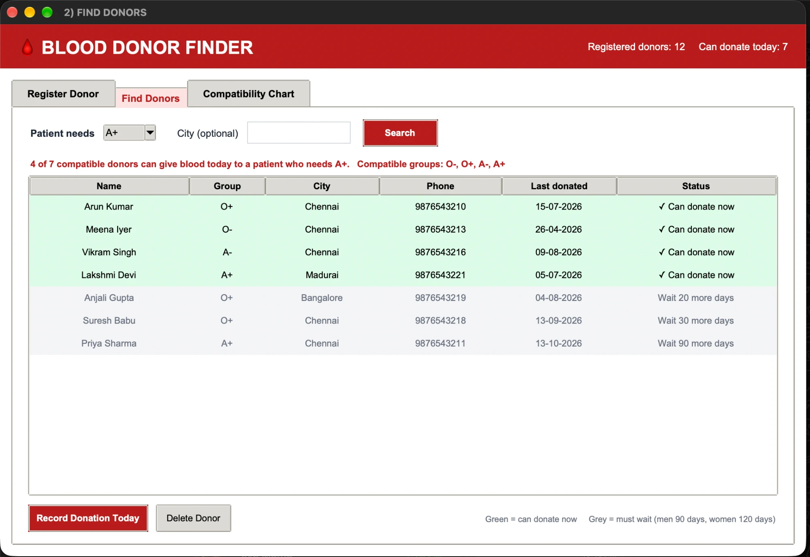
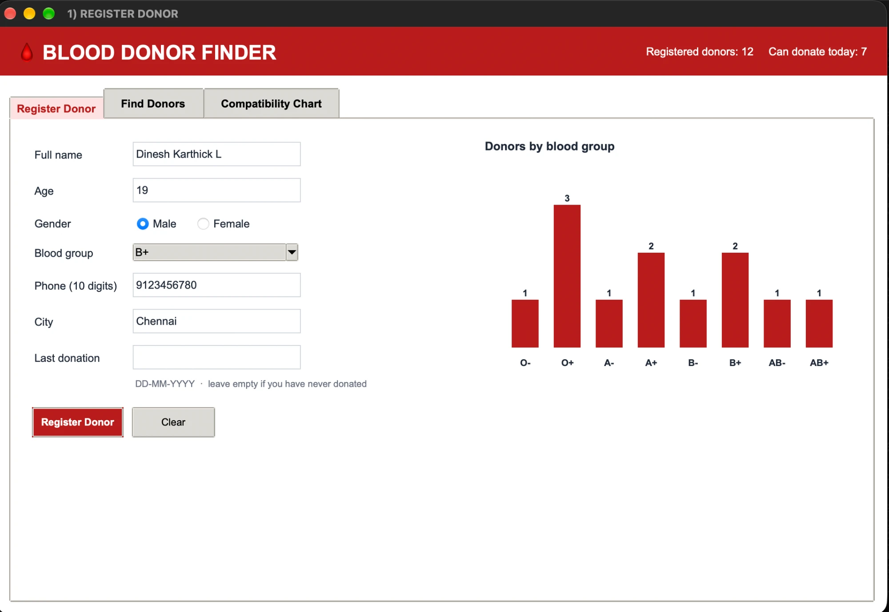
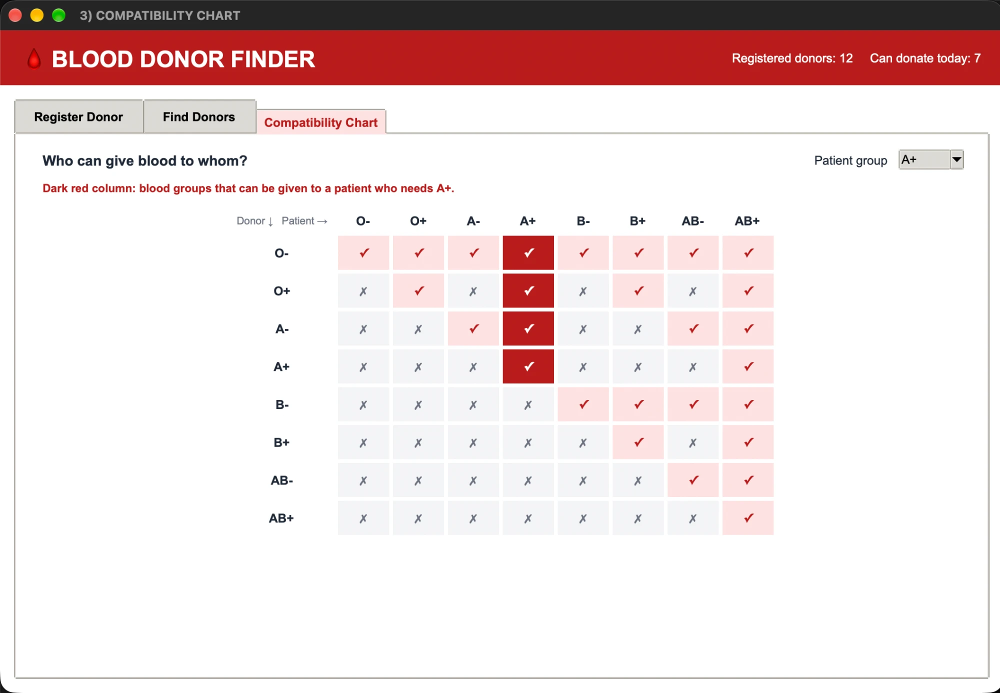
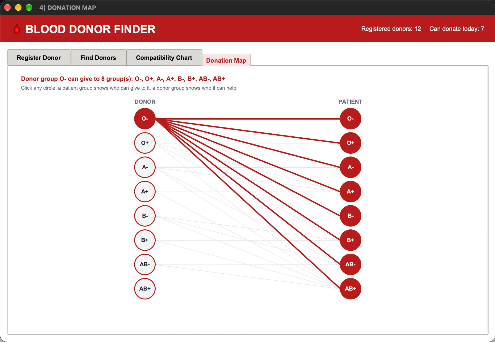

# 🩸 Blood Donor Finder

A desktop app that finds blood donors who can safely give to a patient, and who are allowed to donate **today**.

Built with **Python + Tkinter** (front end) and **SQLite** (back end). Nothing else to install.



## Features

- **Register Donor:** a form with checks (age 18–65, 10-digit phone, a real date that isn't in the future) and a live bar chart of donors per blood group.
- **Find Donors:**
  - Pick the patient's blood group to list every compatible donor, with donors who can give today sorted first.
  - Green rows can donate now. Grey rows must wait (90 days for men, 120 for women).
  - Live city search filters as you type.
  - Double-click a donor to open their donor card.
  - Record a donation or delete a donor.
- **Compatibility Chart:** an 8×8 grid of who can give to whom. The chosen patient's column is highlighted.
- **Donation Map:** click any blood group to see every safe donor → patient link light up.
- **Splash screen** on start-up.
- Data is saved in `donors.db`, so it stays after the app is closed.

## Run it

Requires Python 3.8 or newer (Tkinter and SQLite come with Python).

```bash
python3 blood_donor.py
```

On the first run, the app creates `donors.db` and adds 12 sample donors.

## Screenshots

| Register | Compatibility chart | Donation map |
|---|---|---|
|  |  |  |

## How it works

- `CAN_RECEIVE_FROM` is a dictionary that stores the 27 safe donor → patient pairs. Every feature reads from it.
- `days_left()` works out how long a donor must still wait after their last donation.
- `search_donors()` runs `SELECT ... WHERE blood_group IN (?, ...)` and sorts ready donors to the top.
- All SQL uses `?` placeholders.

---
Mini project for 21CSC203P Advanced Programming Practice, SRM Institute of Science and Technology.
